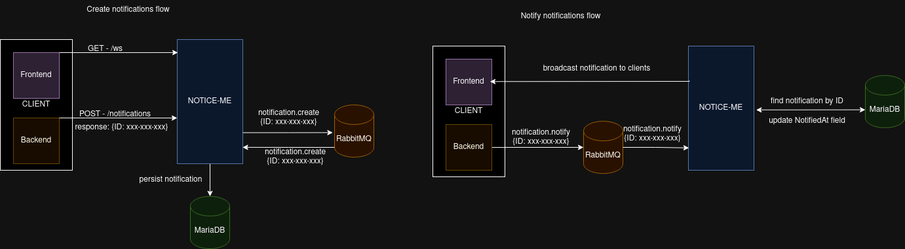

# Notice-Me

[](https://github.com/vicent-dev/notice-me/actions/workflows/go.yml)
[](https://go.dev/)
[](LICENSE)

Notice-Me is a backend microservice that delivers asynchronous notifications to
frontend clients over WebSockets. Producers create notifications through a REST
endpoint or an AMQP queue, and Notice-Me broadcasts each notification to every
connected client that matches the target client id and/or client group id.

Live demo: <https://demo.notice-me.es>

## Features

- **WebSocket fan-out** — connected clients receive notifications in real time.
- **Targeted delivery** — address a specific client (`clientId`), a group
  (`clientGroupId`), or all clients using the wildcard `*`.
- **Asynchronous pipeline** — create and notify flows run through RabbitMQ so
  producers are decoupled from delivery.
- **Instant notifications** — a notification can be persisted and published in a
  single step (`Instant: true`).
- **Persistence** — notifications are stored in MySQL/MariaDB through GORM.
- **Pagination** — list notifications with `page` / `pageSize`.
- **Single binary** — configuration and the Swagger UI are embedded with
  `go:embed`, so the service ships as one executable.
- **Graceful shutdown** — HTTP, WebSocket, and AMQP connections are drained on
  `SIGINT` / `SIGTERM`.

## Architecture

Notice-Me follows a ports-and-adapters (hexagonal) layout. Core domain logic in
`pkg/notification` and `pkg/hub` depends only on interfaces (ports); concrete
infrastructure lives in adapter packages that satisfy those interfaces. This keeps
the domain testable in isolation with mock adapters.



| Layer | Responsibility | Packages |
|-------|----------------|----------|
| **Domain** | Notification model, use-case service, client registry/routing | `pkg/notification`, `pkg/hub` |
| **Ports** | Interfaces the domain depends on | `repository.Repository[T]`, `rabbit.RabbitInterface`, `hub.HubInterface` |
| **Driven adapters** | Persistence and messaging implementations | `pkg/repository` (GORM / MySQL), `pkg/rabbit` (amqp091), `pkg/hub` (gorilla/websocket) |
| **Driving adapters** | Inputs that invoke the domain | `app/handler.go` (HTTP/REST), `app/consumer.go` (AMQP consumers) |
| **Composition root** | Wiring, configuration, lifecycle | `app/`, `cmd/server/main.go` |

### Request & message flow

**Create flow**

1. A producer sends `POST /api/notifications` (or publishes to the
   `notification.create` queue).
2. Notice-Me publishes the notification to the `notification.create` queue.
3. The create consumer persists it and, when `Instant` is `true`, also publishes
   it to `notification.notify`.

**Notify flow**

1. A producer calls `GET /api/notifications/notify/{id}` (or publishes to the
   `notification.notify` queue).
2. The notify consumer marks the notification as notified (`NotifiedAt`) and
   hands it to the WebSocket hub.
3. The hub delivers the payload to every matching client (by id, group, or all).

## Requirements

- [Go](https://go.dev/) 1.23+
- MySQL or MariaDB
- RabbitMQ

## Getting started

```shell
git clone git@github.com:vicent-dev/notice-me.git
cd notice-me
cp static/config.example.yaml static/config.yaml
# edit static/config.yaml (or provide environment variables) for your DB/RabbitMQ
make build
./main
```

For local development `make run` starts the server directly with
`go run ./cmd/server/main.go`.

### Configuration

Configuration is loaded from the embedded `static/config.yaml` at startup (see
`static/embed.go`). Any value may reference an environment variable using the
`${VAR}` or `${VAR:-default}` syntax, which is expanded before the YAML is parsed
(`pkg/config/config.go`).

| Section | Key | Description |
|---------|-----|-------------|
| `server` | `host` | Public host name. |
| | `port` | HTTP listen port (default `8080`). |
| | `cors` | Allowed origins. Use an exact host or `*`. |
| | `env` | Set to `production` to serve TLS; any other value runs plain HTTP. |
| | `tlsKey` / `tlsCert` | TLS key and certificate paths (used when `env: production`). |
| `db` | `user`, `pwd`, `host`, `port`, `name` | MySQL/MariaDB connection (default port `3306`). |
| `rabbit` | `user`, `pwd`, `host`, `port` | RabbitMQ connection (default port `5672`). |
| | `consumersCount` | Number of concurrent consumers per queue. |
| | `queues[]` | Queue definitions: `name`, `exchange`, `durable`, `autoDelete`, `exclusive`, `noWait`. |

The repository ships `docker-compose.yaml` (RabbitMQ + MariaDB) and a systemd unit
`notice-me.service` for VPS deployments. Use `.env.dist` as the template for the
Compose environment variables.

## API reference

| Method | Path | Description |
|--------|------|-------------|
| `GET` | `/ws` | WebSocket upgrade. Optional `id` and `groupId` query parameters (default `*` = all). |
| `GET` | `/api/docs` | Swagger UI. |
| `POST` | `/api/notifications` | Schedule a notification for creation. |
| `GET` | `/api/notifications` | List notifications. Supports `page` and `pageSize`. |
| `GET` | `/api/notifications/{id}` | Fetch a single notification. |
| `DELETE` | `/api/notifications/{id}` | Delete a notification. |
| `GET` | `/api/notifications/notify/{id}` | Notify (broadcast) an existing notification. |

The OpenAPI specification is available in [`swagger.yaml`](swagger.yaml) and the
interactive UI at `/api/docs`. The service does not currently require API keys.

### WebSocket clients

Clients connect to `GET /ws` with optional `id` and `groupId` query parameters:

```
ws://localhost:8080/ws?id=user-42&groupId=admins
```

Both default to `*`. A notification targeting `clientId == "*"` or
`clientGroupId == "*"` is broadcast to all connected clients; otherwise it is sent
to clients whose `id` or `groupId` matches.

### Creating a notification

```http
POST /api/notifications
Content-Type: application/json

{
  "Body": "Import finished",
  "ClientId": "*",
  "ClientGroupId": "*",
  "Instant": false,
  "OriginClientId": ""
}
```

`Body`, `ClientId`, and `ClientGroupId` are required. Set `Instant: true` to
persist and notify in one step; otherwise call
`GET /api/notifications/notify/{id}` (or publish to `notification.notify`) when the
work completes.

## Project layout

```
cmd/server/        Application entrypoint
app/               Composition root: routes, HTTP handlers, middleware,
                   AMQP consumers, DB/AMQP bootstrap
pkg/config/        Configuration loading with environment-variable expansion
pkg/hub/           WebSocket hub and client (port interface + adapter)
pkg/notification/  Domain entity and service (create/notify/delete/pagination)
pkg/rabbit/        AMQP adapter
pkg/repository/    Generic repository port, GORM adapter, pagination helper
static/            Embedded config and Swagger UI assets
swagger.yaml       OpenAPI specification
```

## Development

### Make targets

| Target | Command |
|--------|---------|
| `make run` | `go run ./cmd/server/main.go` |
| `make test` | `go test -v ./... -cover` |
| `make build` | `go build ./cmd/server/main.go` |
| `make build-restart` | Build and `systemctl restart notice-me` |

### Testing strategy

Tests are organised along the same hexagonal boundaries as the code:

- **Domain** tests (`pkg/notification`, `pkg/hub`) run against in-memory port
  mocks — `pkg/repository/mock`, `pkg/rabbit/mock`, and `pkg/hub/mock` — with no
  database or broker required.
- **Driven adapters** are tested directly: the GORM repository runs against an
  in-memory SQLite database (`github.com/glebarez/sqlite`, a no-CGO test
  dependency), and the WebSocket hub is exercised over real upgrade connections.
- **Driving adapters** (HTTP handlers, middleware, routes, consumers) are tested
  with `net/http/httptest` and the port mocks.
- RabbitMQ adapter methods that require a live broker are covered manually; the
  rest of the AMQP adapter is unit-tested for lifecycle behavior.

Run the suite with coverage:

```shell
go test ./... -cover
```

Current statement coverage: `pkg/notification` ~97%, `pkg/repository` ~97%,
`pkg/config` ~94%, `pkg/hub` ~87%, `app` ~70% (the remainder is DB/AMQP
bootstrap code that requires live infrastructure).

### Continuous integration

The GitHub Actions workflow in [`.github/workflows/go.yml`](.github/workflows/go.yml)
builds and runs the test suite on every push and pull request to `main`.

## License

Released under the [BSD License](LICENSE).
